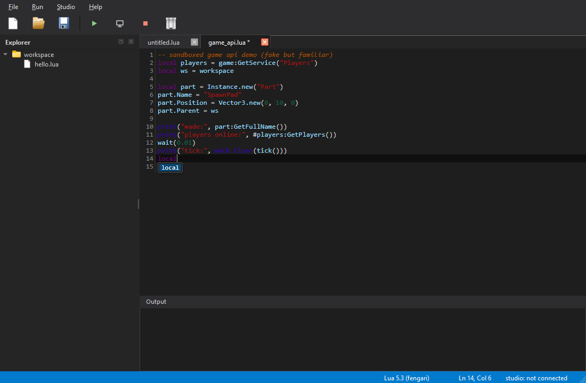

# lualite

a mini visual-studio-ish editor for lua. runs actual lua 5.3 inside the app,
talks to roblox studio over a local bridge, and has a dumb little mcp-ish
endpoint because i wanted to see how tools get wired up.

made it after chameleon cause i wanted an editor for the game scripts i keep
writing. took a while, the webview bridge part was honestly a nightmare.

## how to run

```
py -3.14 -m pip install PySide6
py -3.14 lua_engine.py
```

first launch downloads codemirror + fengari (~400kb) into
%LOCALAPPDATA%\LuaLite\web-cache so it works offline after that.

## what it looks like



## stuff it does

- tabs, open/save .lua, dirty markers, ctrl+f find, ctrl+g goto line,
  ctrl+/ comment toggle, bracket matching
- autocomplete pops up on its own while you type (or ctrl+space to force it)
- live syntax check - broken lines get shaded red with the real lua error
  in the status bar half a second after you stop typing
- run button (or F5) executes the script in a real lua 5.3 vm (fengari
  compiled to js). print/warn go to the output box, errors show up red with
  the real lua error message. stop button kills runaway scripts via a
  lua hook that counts instructions
- file > sample has a few demos (metatables, coroutines, the fake game api)
- explorer sidebar shows the scripts/ folder. right click it for
  new file / new folder / delete / refresh. double click to open
- sandbox globals: game, workspace, script, Instance.new, Vector3, Enum,
  tick, wait, task. they are stubs but they behave close enough to mess
  around with game-style code

## roblox studio bridge

this is the fun part. the app runs a tiny http server (port 28350) and
studio polls it:

1. Studio > Install Studio plugin (writes lualite_bridge.lua into
   %LOCALAPPDATA%\Roblox\Plugins)
2. restart studio. each open place announces itself with its own id, the
   status bar shows the place names that connected
3. Studio > Refresh Studio tree fills the explorer with the places' real
   file trees, one section per place (workspace, serverscriptservice etc).
   double click a script and its source opens in a tab
4. Studio toolbar button (or Run script in Studio) queues the current tab's
   code for every connected place to run inside studio

honest limits: loadstring inside plugins is restricted so the execute path
mostly works in playtest/command bar contexts. the tree browsing works
everywhere though.

## the mcp-ish thing

POST /mcp on port 28350 with {"method":"tools/list"} or tools/call with:

- studio_tree - the file trees every connected place sent (per session)
- studio_execute - queue lua code inside studio
- editor_open - creates a file in the workspace and opens it in a tab

its not a full mcp implementation, just the tool shape so external stuff can
poke at it. good enough for experiments.

## how it works inside

- the ui is Qt (PySide6). the editor itself is a QWebEngineView running
  codemirror, served by a tiny 127.0.0.1 http server in the same process
  so the page gets a real origin
- python <-> js through QWebChannel. js calls python via @Slot methods,
  python pushes code/config via signals
- lua runs on fengari (lua 5.3 vm compiled to javascript). its actual lua
  semantics - metatables, coroutines, string.format, all of it
- studio plugins poll /studio/poll with their session id every half second
  and post results back

everything is one file on purpose (lua_engine.py, ~1200 lines) cause i like
being able to read the whole thing top to bottom.
